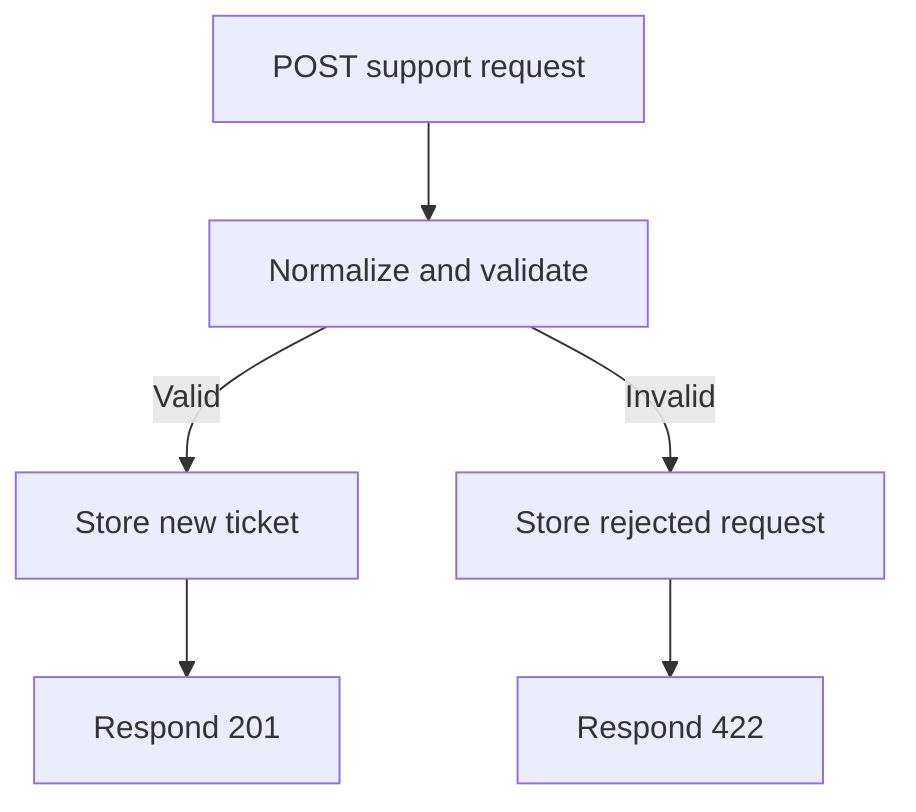

# Armans.AI — Shopify SupportOps

A development-store portfolio project for connecting Shopify data and organizing customer support requests with n8n.

**Current scope:** a Shopify product-read integration and a separate support-intake workflow. This repository does not yet implement an end-to-end AI support agent or demonstrate a production client deployment.

## The business problem

A small ecommerce team needs consistent information when a customer asks about an order, a return, or a product. This project explores the foundations: retrieve store data, collect a structured request, validate it, and record its status for a person to review.

The next proposed increment is an assistant that drafts responses from approved policies and verified order information. That increment is planned, not implemented here.

## What is implemented

| Component | Evidence in this repository | What the evidence establishes |
| --- | --- | --- |
| Shopify product read | [Day 1 workflow](n8n-workflows/day1-shopify-admin-graphql-Safe.json), [test report](test-reports/day1-test-report.md), [screenshots](screenshots/) | A recorded development-store integration using the Admin GraphQL API and `read_products`. Current credentials and connectivity have not been retested in this documentation update. |
| Support request intake | [Day 2 workflow](n8n-workflows/D2%20-%20Shopify%20Support%20Intake.json) | The export defines POST intake, field normalization, basic validation, Supabase writes, and separate success/rejection responses. |
| Intake execution record | [Day 2 test report](test-reports/test-reports/day2-support-intake-tests.md) | The historical report records 201/422 responses, database storage, browser journeys and 10/10 acceptance tests. It does not include individual test inputs, outputs, or execution IDs; a fresh reproducible run is still needed. |

The two workflows are separate. The support-intake export does not look up a Shopify order, verify customer ownership of an order, call an AI model, or send a support reply.

## Support-intake flow

Accepted request categories are `order_status`, `return`, `product_question`, and `other`. The exported validation checks for a nonempty name and message, a basic email pattern, and an allowed category. Both branches attempt database storage before responding.

## Review the project

1. Read the [case study](docs/PORTFOLIO-CASE-STUDY.md) for the business context and exact scope.
2. Use [START_HERE](START_HERE.md) for the evidence map and reproduction prerequisites.
3. Review the [client-readiness checklist](docs/CLIENT-READINESS.md) before adapting this project for a client.
4. See the [original Day 1 README](docs/history/README-day1.md) for the historical implementation notes.

## Current limits

- Development-store and portfolio evidence; no verified commercial results, savings, or customer satisfaction claims.
- No order/customer lookup, policy retrieval, AI classification, approval interface, refund processing, or outbound support messaging in the reviewed intake export.
- No explicit webhook authentication, deduplication, rate limiting, or database-failure recovery is shown in that export. Controls outside the export have not been assessed.
- Database schema, access policies and a complete fresh-install procedure still need to be documented and tested.
- Invalid requests currently retain submitted fields in the database; retention and data minimization need a deliberate design before a client pilot.
- The workflow export's `active` flag is not evidence that an endpoint is currently online.

## Responsible demonstration

Use synthetic customer requests and a development store. Keep API tokens and database credentials outside the repository, remove sensitive execution data from exports, and redact screenshots. A public demo should not expose unrestricted production endpoints or customer information.

## Owner

Rehman Nadeem — Founder, Armans.AI · Lahore, Pakistan  
[GitHub profile](https://github.com/rehmannadeem) · [LinkedIn](https://www.linkedin.com/in/rehman-nadeem-1b4002390/)

Documentation review: 31 October 2026. This update reviews repository evidence; it does not constitute a new runtime acceptance test.
