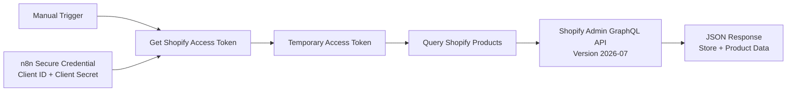

# Armans.AI Shopify SupportOps Engine

Building reliable Shopify AI support and post-purchase automation systems with n8n, APIs, RAG, and human approval.

## Day 1 objective

Prove that n8n can securely authenticate with a Shopify development store and retrieve genuine store data through the Shopify Admin GraphQL API.

## Verified Day 1 technical result

- Shopify development store created: `Karachi Kicks SupportOps Lab`
- Recognizable test product created: `Karachi Kicks Runner Pro`
- Shopify app created: `Armans SupportOps Connector`
- App scope released: `read_products`
- App installed on the development store
- n8n obtained a temporary Shopify access token
- n8n executed an Admin GraphQL query successfully
- Shopify returned the store identity and product data as JSON
- Exposed credentials were rotated during testing

## Architecture



## n8n workflow

### Node 1 — Manual Trigger
Starts the workflow manually for controlled testing.

### Node 2 — Get Shopify Access Token
- Type: HTTP Request
- Method: `POST`
- Endpoint: `https://STORE-NAME.myshopify.com/admin/oauth/access_token`
- Authentication: Generic Credential Type → Custom Auth
- Body content type: Form URL Encoded
- Visible body field: `grant_type=client_credentials`
- Client ID and Client Secret: stored inside the n8n credential vault

Expected response: `access_token`, `scope`, `expires_in`.

### Node 3 — Query Shopify Products
- Type: HTTP Request
- Method: `POST`
- Endpoint: `https://STORE-NAME.myshopify.com/admin/api/2026-07/graphql.json`
- Headers: `Content-Type: application/json` and `X-Shopify-Access-Token`
- Body content type: JSON

```graphql
query {
  shop { name myshopifyDomain }
  products(first: 5, query: "handle:karachi-kicks-runner-pro") {
    edges { node { id title handle vendor productType } }
  }
}
```

Expected paths:

```text
data.shop.name
data.shop.myshopifyDomain
data.products.edges[0].node.title
data.products.edges[0].node.handle
```

## Security rules

- Never commit Client ID, Client Secret, or access tokens.
- Keep secrets inside n8n credentials.
- Redact secrets from screenshots.
- Rotate credentials immediately if exposed.
- Inspect the n8n export before committing it.

## Current limitations

- Development-store proof only.
- Current scope is `read_products`.
- No order/customer access yet.
- No production webhook, retries, alerts, database, RAG, or human approval yet.
- This is a foundation proof, not a production-ready client system.

## Day 1 acceptance evidence

1. Safe GraphQL-success screenshot.
2. Sanitized n8n workflow export.
3. Architecture file.
4. GitHub commit.
5. Public Armans.AI skeleton.
6. Updated progress log.

## Owner

Nadeem — Founder, Armans.AI  
Lahore, Pakistan

